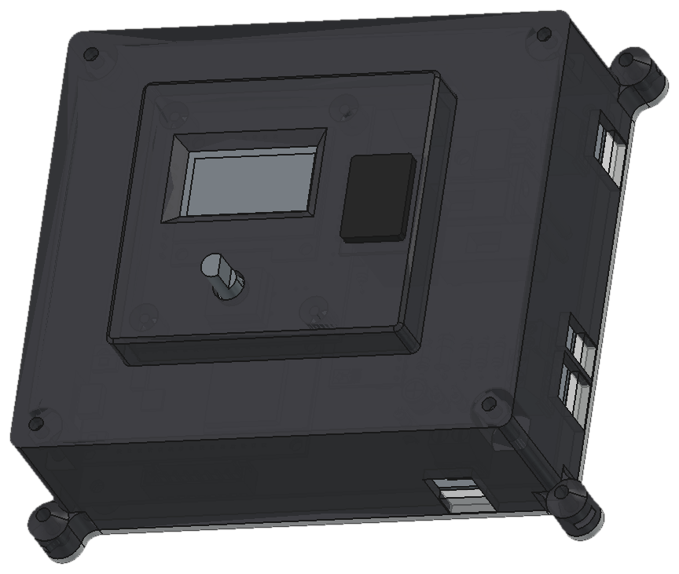
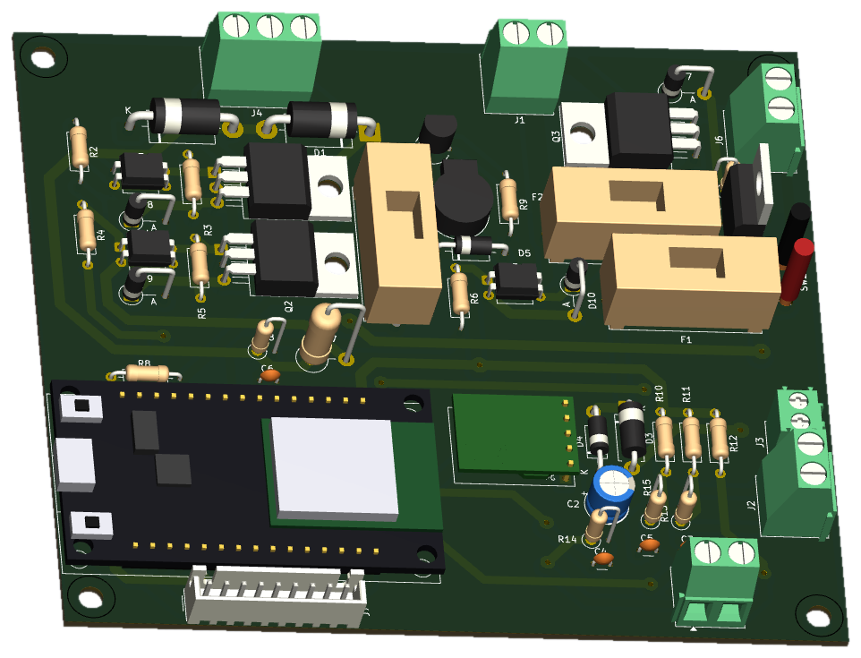
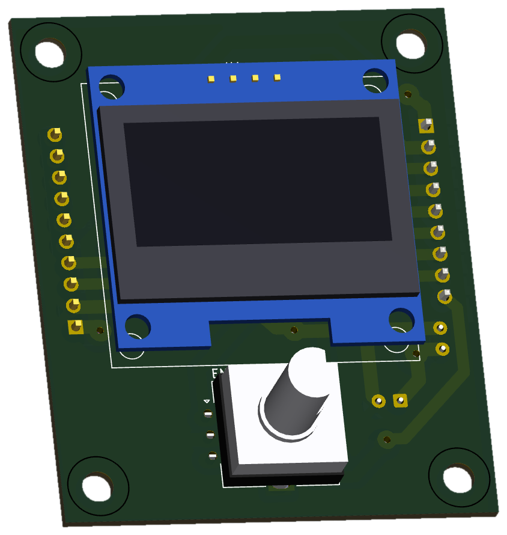

# Tank-Manager

Controller for a gray and a clean water tank, powered from 12 V. An ESP32 measures the tank
levels, the gray water temperature and the tilt of the device, drives the gray water drain valve,
a tank heater and an overfill buzzer, and is operated from a front panel (OLED display and rotary
encoder) or from a phone app over Bluetooth LE.

This repository holds the hardware design and the firmware. The compatible Android app is in
[TheGrycek/Tank-Manager-App](https://github.com/TheGrycek/Tank-Manager-App).

  

## Folders

| Folder | Contents |
| --- | --- |
| [`esp32/`](esp32/) | MicroPython firmware of the controller |
| [`PCB-design/`](PCB-design/) | KiCad project of the main board |
| [`PCB-front/`](PCB-front/) | KiCad project of the front panel board |
| [`temp_sensor/`](temp_sensor/) | Characterisation of the NTC temperature sensor |
| [`images/`](images/) | Renders of the boards and the enclosure used in this README |

### `esp32/`

The firmware: sensor readout, valve, heater and buzzer control, the display menu, Bluetooth LE
communication with the app and the MPU calibration. The components, pins, Bluetooth
characteristics and the calibration procedure are described in [`esp32/README.md`](esp32/README.md).
The phone side is the Android app [Tank-Manager-App](https://github.com/TheGrycek/Tank-Manager-App).

### `PCB-design/`

KiCad project of the main board (`PCB-design.kicad_sch` on an A3 sheet split into functional
blocks, `PCB-design.kicad_pcb`).

  

It carries:

- the ESP32 DevKitC module, powered with 5 V into its VIN pin (its own regulator makes the 3.3 V),
- the 12 V input with reverse polarity protection (P-MOSFET Q5), an on/off switch, time-lag fuses
  (F1 500 mA logic, F2 3.15 A heater, F3 200 mA fast valve) and a transient suppressor, and a Pololu
  D24V10F5 5 V step-down regulator mounted upside down (header soldered from the other side,
  footprint `Pololu_D24V10F5_Rev`),
- power MOSFETs with 15 V gate clamps and PC817 optocouplers for the valve and heater outputs,
- the buzzer with a BS170 transistor,
- the resistor dividers, RC filters (4.7 kΩ + 100 nF) and screw terminals for the level sensors
  (5 mm) and the temperature sensor (smaller 3.5 mm terminal, J3),
- the valve switched on the +12 V side: the common (green-yellow) wire on GND, +12 V on the open
  (blue) or close (brown) wire through a P-MOSFET,
- a 10 Ω shunt in the valve return for measuring the motor current (GPIO33),
- a 9-pin JST XH (2.54 mm clone) connector to the front panel (J7).

The board is 116 x 99.5 mm. It is made by hand (no plated holes): a pad has copper only on the
layers its tracks use, through-hole connections are wires soldered on both sides, and tracks reach
the component side only at parts that are easy to solder from the top. KiCad's footprint-library
comparison is switched off in the design rules, because the pads differ from the library on
purpose. The heating foil was measured at 1.8 A at 12.8 V (about 7.1 Ω,
2.0 A at 14.4 V); F2 is sized for that. The valve motor was measured at about 30 mA while moving;
the 10 Ω shunt (300 mV at the ADC) and the fast 200 mA F3 are sized for that.

`Custom_components.pretty/` holds the footprints drawn for this project (ESP32 DevKitC,
MPU-9250, SH1106 OLED, Pololu D24V10F3 and the upside-down D24V10F5); the front panel project uses them too.

### `PCB-front/`

KiCad project of the front panel board (`PCB-front.kicad_sch`, `PCB-front.kicad_pcb`): the
1.3" SH1106 OLED display, the EC12 rotary encoder, the MPU-9250 module, the 9-pin JST XH
connector to the main board (J1; a 9-wire cable with XH plugs at both ends, pins 1:1) and 10 µF + 100 nF decoupling on the 3.3 V supply.

  

### 3D models and the enclosure

`PCB-design/3d_models/` holds the models of the parts that have none in the KiCad library: the ESP32
DevKit (DOIT, 30 pins), the 1.3" I2C OLED module, the EC12E encoder (shaft 20 mm above the board),
the MPU-9250 module and the switch wires. They are simplified models drawn from the footprints and
from the modules' dimension drawings (the OLED from the LCDWiki MC130VX drawing), as STEP files that
FreeCAD opens for editing. The Pololu regulator uses Pololu's own STEP (from pololu.com, product
2831), turned upside down to match the `Pololu_D24V10F5_Rev` footprint. Check the dimensions against the parts you have.

`mechanical/` has both boards exported with all parts as STEP (`kicad-cli pcb export step`), for
designing the enclosure in FreeCAD. Heights above the board surface: encoder shaft 20.0 mm and OLED
glass 5.2 mm (front panel), Q5 18.8 mm, R17 15.6 mm and the screw terminals 13.8 mm (main board).
Re-export them after changing a board.

### `enclosure/`

3D-printed enclosure: one body with a removable back cover, mounted from behind the plywood
(about 10 mm).

- **Body** (`body.stl`): box 123 x 106.5 mm behind the plywood with a centred nose 72.8 x 66.8 mm on
  its front. The nose goes through a **73.8 x 67.8 mm** hole in the plywood and stands 2 mm proud of
  its front face; the front wall of the box rests on the back of the plywood. The nose holds the front
  board (self-tapping plastic screws into 7 mm standoffs), the display window (bevelled), the encoder shaft
  hole and the cut-out for the main switch.
- **Mounting:** four M3 x 16-25 screws (pan head with a washer) from the front through 3.5 mm holes
  in the plywood (at x = +-55.5 mm, y = +-47.25 mm from the centre of the hole) into bosses in the
  corners of the front wall of the box. Their nuts slide into the bosses from the inside of the box
  (through the open back); the bosses are closed at the back end, so a screw that is too long stops
  there and cannot reach the main board. The plywood screws hold only the body.
- **Back cover** (`back_cover.stl`): the main board is screwed to 5 mm standoffs on it (self-tapping
  plastic screws in blind holes; the cover plate under them stays closed), and
  the cover is held by 4 M3 screws through ears at the back corners of the body. Their nuts slide into
  slots in the outer side of the ears; the holes go right through the ears, so any screw from
  M3 x 10 up fits. The ears blend into the walls of the body and the cover with rounded notches. A
  drop of glue keeps the nuts from falling out while the cover is off.
- The openings for the wires of the screw terminals and for the ESP32 USB socket are slots in the side
  walls, open towards the back edge; fingers on the cover close them behind the wires. The cover comes
  off together with the main board without unscrewing any wire. Give the JST XH cable to the front
  board 15-20 cm, so the cover can be laid aside with the cable connected.
- Total depth 56 mm: 2 mm in front of the plywood, 44 mm behind it. The depth is set by the main switch
  (~30 mm deep) over the fuse holder F1 of the main board.

Parts: main switch KCD1 type (snap-in rocker, cut-out 19.2 x 12.9 mm, the panel is 2 mm thick around
it), 8 M3 nuts, 4 M3 x 16-25 screws with washers for the plywood, 4 M3 x 10 (or longer) screws for the
cover, and 8 self-tapping plastic screws for the two boards: 2.8 mm thread (2.27 mm core, coarse pitch),
7 mm long, head up to 7.8 mm wide, into 2.4 mm pilot holes 6-6.5 mm deep. Insulating TO-220 bushings
(3 mm hole, collar into the board's 3.5 mm mounting holes) under the heads keep the metal off the
boards.

Print the body nose down (the front wall of the box and the cones under the ears need supports); print
the cover flat, standoffs up. Mounting: screw the front board into the nose and fit the switch, fix the
body to the plywood, wire the screw terminals on the main board (their screws face the open side of
the cover), connect the JST XH cable and the switch wires, then screw the cover on. Trim the leads of
Q5 (vertical TO-220) to ~3 mm, it stands over the cover.

`body.step` and `back_cover.step` are the parts for editing in a CAD program, the STL files are ready
for printing; `enclosure.FCStd` opens both parts with the boards in place in FreeCAD.

### `temp_sensor/`

Data and a script used to find the temperature curve of the NTC 10k sensor:

- `ntc10k_nominal.csv`: nominal, minimum and maximum resistance of the thermistor from -40 °C,
- `r-t_curve.csv`: resistance measured on the actual sensor,
- `r-t_curve.py`: fits the Steinhart-Hart coefficients to the nominal data and plots them
  against the measurements. It needs `numpy`, `pandas`, `scipy` and `matplotlib`.

The fitted coefficients are the ones used by `TemperatureSensor` in `esp32/sensors.py`.

## License

MIT, see [`LICENSE`](LICENSE).
